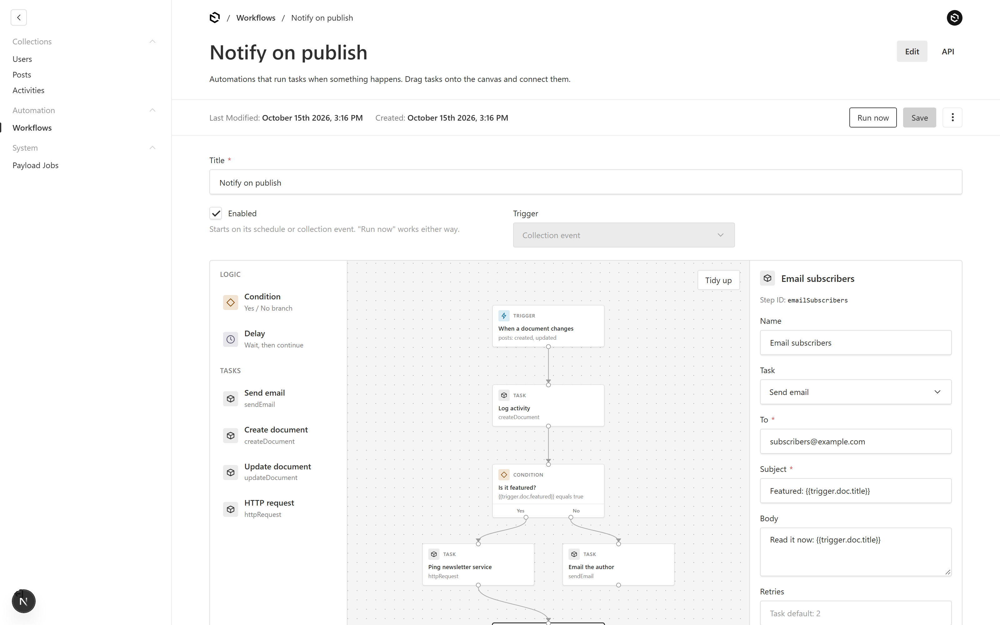
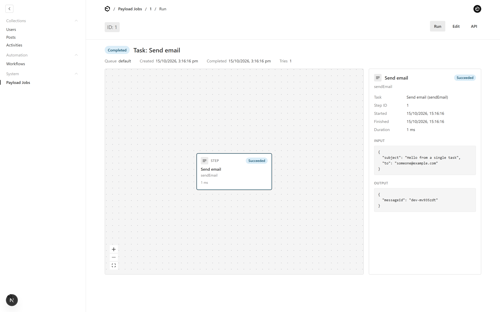
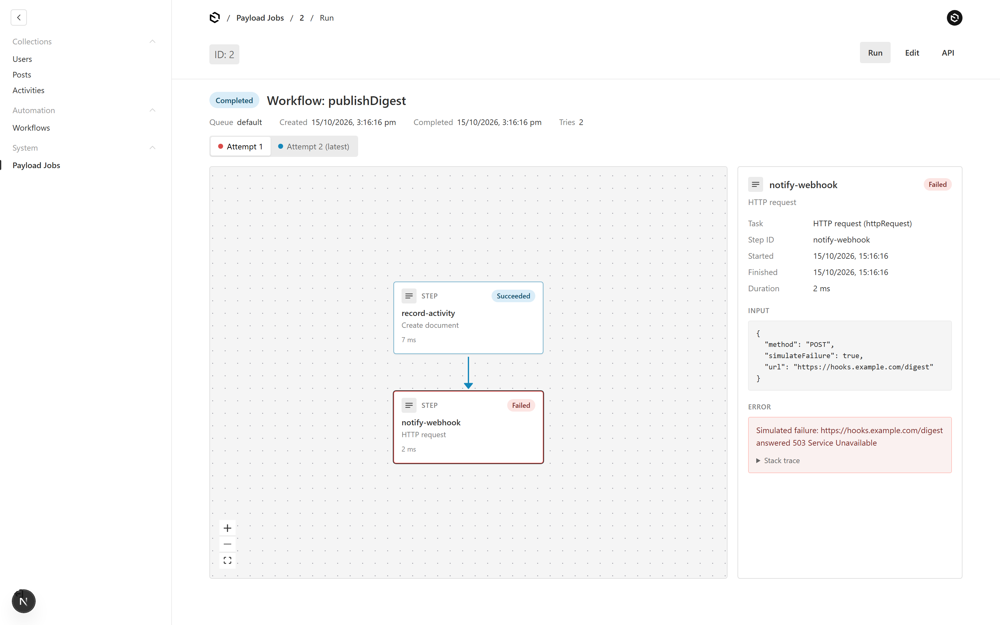
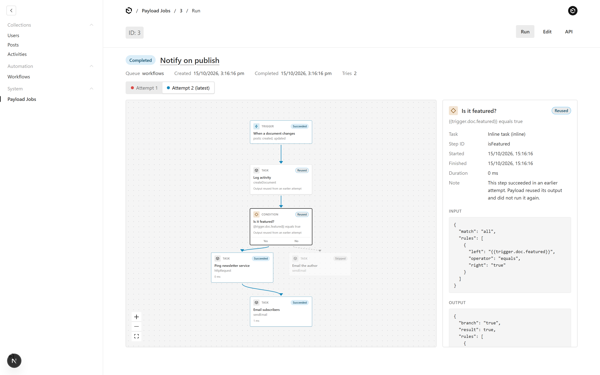
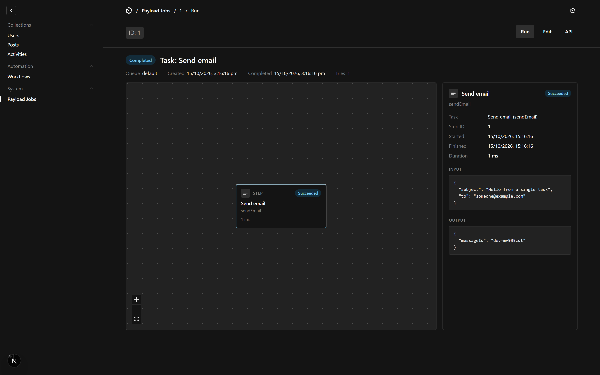
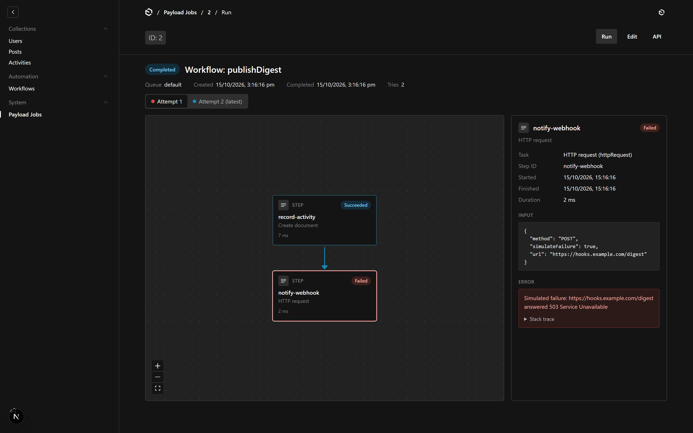
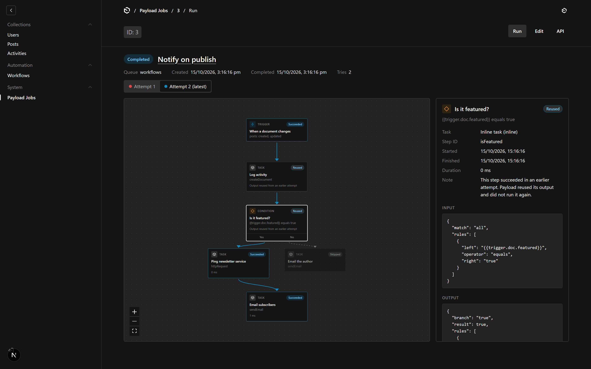
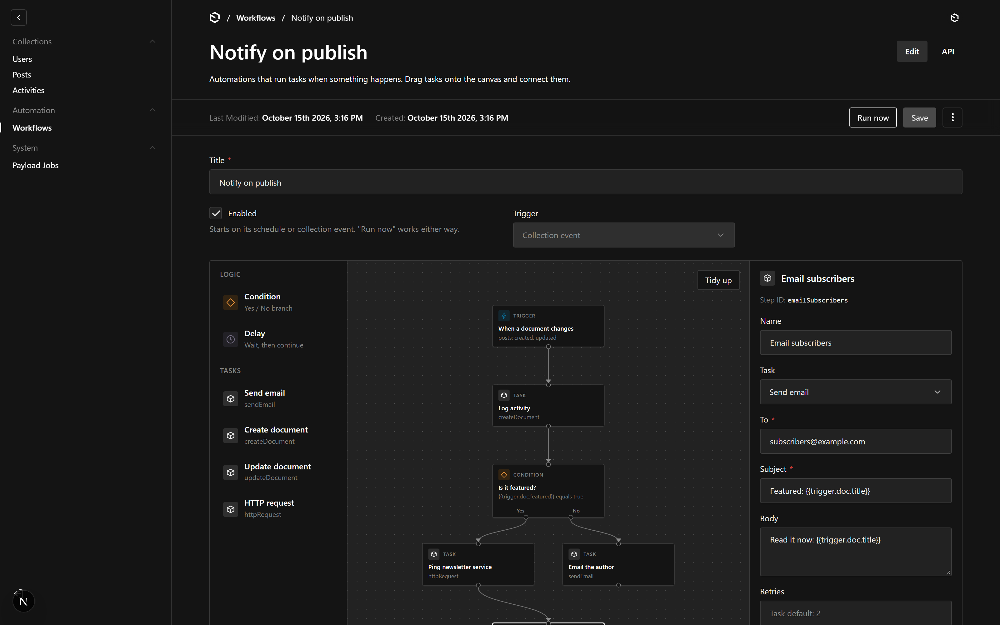

# payload-workflows

Visual workflows for [Payload CMS](https://payloadcms.com) 3.

- **Run viewer.** Every job in `payload-jobs` gets a **Run** tab that draws the job as a graph: one node per task run, a picker for each retry attempt, and a side panel with each step's input, output and error. Running jobs update by themselves.
- **Workflow builder.** A `workflows` collection where editors build automations by dragging tasks onto a canvas and connecting them, with no code. Workflows start manually, on a schedule, or when a document is created, updated or deleted. They run on Payload's own jobs queue, with Payload's retries.



## Requirements

- Payload `^3.90`, Next.js `^16.3`, React 19
- At least one task in `jobs.tasks` (the builder places your own tasks on the canvas)

## Install

```sh
pnpm add payload-workflows
```

```ts
// payload.config.ts
import { workflowsPlugin } from 'payload-workflows'

export default buildConfig({
  // ...
  jobs: {
    tasks: [sendEmail, createDocument /* your tasks */],
  },
  plugins: [
    workflowsPlugin({
      collections: ['posts'], // collections whose events can start a workflow
    }),
  ],
})
```

Then regenerate the import map and types:

```sh
pnpm payload generate:importmap
pnpm payload generate:types
```

## The run viewer

Open any job under **System → Payload Jobs** and click the **Run** tab.

| Single task | Code workflow with a retry | Visual workflow with a condition |
| --- | --- | --- |
|  |  |  |
|  |  |  |

- **Attempts.** When a task fails and Payload retries the job, each try is an attempt. Payload does not run steps that already succeeded again: it reuses their output. The viewer marks those steps **Reused**.
- **Code workflows and single tasks** show the task runs in order.
- **Visual workflows** show the workflow's own graph. Steps that ran are solid, the path taken is highlighted, a failed step is red, and steps on a branch that was not taken are **Skipped**.
- Click a step to see its input, output, timing and error with the stack trace.
- While a job is queued or running, the tab refreshes every 2 seconds.
- React Flow loads only on this tab and in the builder, so the rest of the admin stays light.

The plugin keeps completed jobs, so the viewer can show them. It does this by setting `jobs.deleteJobOnComplete: false` when your config does not set it. Set `keepCompletedJobs: false` to keep Payload's default, which deletes them.

## The workflow builder

Open **Automation → Workflows** and create a workflow.



1. **Trigger.** Every workflow starts with one trigger. Select it to choose when it starts:
   - **Run manually**: only with the **Run now** button.
   - **On a schedule**: a cron expression, such as `0 9 * * 1-5` for 09:00 on weekdays, with an optional time zone. The panel shows the next three runs.
   - **When a document changes**: a collection, the operations (created, updated, deleted), and optional rules, such as "`{{trigger.doc.status}}` equals `published`".
2. **Steps.** Drag a task from the left onto the canvas, or click it to add it after the selected step. Drag from a step's bottom handle to the next step's top handle to connect them.
   - **Task** runs one of your registered tasks. Its form is built from the task's `inputSchema`.
   - **Condition** checks rules and continues on its **Yes** or **No** handle.
   - **Delay** waits for a number of seconds, minutes, hours or days, then continues.
3. **Values.** A task input can be a fixed value or a reference to data from earlier in the run:
   - `{{trigger.doc.title}}`: the document that started the workflow (`trigger.previousDoc` for updates)
   - `{{trigger.data.email}}`: the test data of a manual run
   - `{{steps.<stepId>.output.messageId}}`: the output of an earlier step
   - `{{workflow.title}}`

   A field that holds only one reference keeps the value's type (a number stays a number). References inside text become text. The **References** list in the side panel shows what the selected step can use. Click a field, then click a reference to add it.
4. **Checks.** The builder checks the workflow as you edit: exactly one trigger, no loops, every step connected, required inputs filled, and references that point at steps that run earlier. Problems show on the steps and in the corner of the canvas.
5. **Save, then enable.** A workflow only starts on its schedule or on collection events when **Enabled** is on. You cannot enable a workflow that has problems. **Run now** works on a saved workflow either way, and opens the new job's Run tab.

**Tidy up** arranges the steps in rows. **Delete** or **Backspace** removes the selected step or connection.

## How it runs

The plugin registers one Payload workflow, `payloadWorkflowsRun`. Every visual workflow run is a job of that workflow. The job input holds the workflow id, a copy of the graph, and the trigger data. Because the job has its own copy of the graph, editing a workflow does not change runs that already started.

The runner walks the graph from the trigger:

- A **Task** step calls `tasks[slug](stepId, { input })`, the same call a code workflow makes. Payload's per-task `retries`, backoff and resume-after-failure apply as usual: on a retry, steps that already succeeded return their saved output.
- A **Condition** runs as an inline task. Its output records the branch, so a retried job takes the same path.
- A **Delay** queues the rest of the run as a new job with `waitUntil`, and ends the current job. The new job's Run tab links back to the first one.
- A step runs when at least one of its incoming connections is on the path. Steps that are never reached are skipped.

**Triggers:**

- **Run now** queues a job and starts it at once.
- **Schedule.** The plugin registers one task, `payloadWorkflowsSchedule`, which Payload's scheduler queues every minute. It queues every enabled schedule workflow whose next run time has passed, and moves that time on. You do not edit your config for each workflow.
- **Collection events.** The plugin adds `afterChange` and `afterDelete` hooks to the collections in `collections`. They queue every enabled workflow that matches the collection, the operation and the rules. The job is queued in the same transaction as the change.

By default the plugin adds a `jobs.autoRun` entry that processes its queue (`workflows`) every minute. On serverless hosts, set `autoRun: false` and call these from your own cron:

```
GET /api/payload-jobs/handle-schedules?queue=workflows
GET /api/payload-jobs/run?queue=workflows
```

## Options

```ts
workflowsPlugin({
  enabled: true,            // turn the whole plugin off
  runViewer: true,          // or { refreshInterval: 2000, showJobsInNav: true }
  builder: true,            // the workflows collection, builder and runner
  slug: 'workflows',        // slug of the workflows collection
  collections: [],          // collections whose events can start workflows
  tasks: undefined,         // string[] or (task) => boolean; which tasks appear in the palette
  queue: 'workflows',       // jobs queue for runs and the scheduler
  autoRun: true,            // or { cron: '* * * * *', limit: 10 }, or false
  keepCompletedJobs: true,  // set deleteJobOnComplete: false unless you set it
  maxChainDepth: 3,         // how many workflows may trigger each other in a chain
  access: {
    workflows: ({ req }) => ..., // read/create/update/delete on the workflows collection
    run: ({ req }) => ...,       // who can use Run now
    jobs: ({ req }) => ...,      // read access to payload-jobs, used by the viewer
  },
})
```

Each access function defaults to "a user of the admin user collection is signed in". The plugin sets `jobs` read access only if your config left it at Payload's default, which denies everyone.

The palette lists every task in `jobs.tasks` except the plugin's own scheduler and Payload's internal `schedulePublish`. Only palette tasks can run in visual workflows.

### Existing `jobsCollectionOverrides`

If your config has `jobs.jobsCollectionOverrides`, the plugin runs it first and adds the Run tab to its result. It does not replace it.

## Writing tasks for the builder

The builder reads each task's `label`, `inputSchema` and `outputSchema`:

```ts
const sendEmail: TaskConfig<'sendEmail'> = {
  slug: 'sendEmail',
  label: 'Send email',
  inputSchema: [
    { name: 'to', type: 'email', required: true },
    { name: 'subject', type: 'text', required: true },
  ],
  outputSchema: [{ name: 'messageId', type: 'text' }],
  retries: 2,
  handler: async ({ input, req }) => {
    // ...
    return { output: { messageId } }
  },
}
```

- `text`, `textarea`, `email`, `number`, `date`, `relationship` and `upload` fields become text inputs that accept references. `select` and `radio` fields become a select. `checkbox` becomes a checkbox. `json`, `group`, `array` and other fields become a JSON text area.
- The runner converts text to the field type before it calls the task: `"42"` becomes `42` for a number field, and JSON text is parsed for a JSON field. Empty values are left out.
- `outputSchema` field names appear as references in later steps.
- Pass `req` to Local API calls in your tasks. Then a task that updates a document counts toward `maxChainDepth`, and a workflow cannot trigger itself forever.

## Known limits

- **Delay** needs a job runner that keeps running, such as `autoRun` or your own cron. The steps after a Delay must only be reachable through that Delay.
- Branches run one after another, not in parallel.
- Collection triggers fire on drafts and autosaves too. Add a rule such as `{{trigger.doc._status}}` equals `published` if you only want published changes.
- **Run now** starts the job without waiting for it. On serverless hosts the job may finish on the next cron run instead.
- There are no loops and no custom code steps, on purpose. Put logic in a task.
- References read values only. They do not support formatting or arithmetic.

## Develop

```sh
pnpm install
pnpm dev:seed        # resets dev/dev.db to the demo data (a user, posts, workflows, jobs)
pnpm dev             # http://localhost:3060/admin, logs in as dev@payloadcms.com / test
pnpm verify          # typecheck, lint, tests
pnpm build           # dist/
pnpm screenshots     # retakes docs/screenshots/ from the running dev app
```

## Credits

The run viewer started from Payload's draft pull request [payloadcms/payload#9645](https://github.com/payloadcms/payload/pull/9645) ("feat: visualize jobs") by Alessio Gravili, which drew job logs with React Flow and planned JSON workflows built in the admin. Payload is MIT licensed. The graphs use [React Flow](https://reactflow.dev).

## License

MIT © Eugene Lominos
